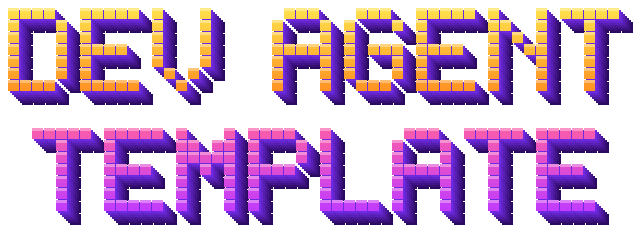

<h1 align="center">
  
</h1>

A lean setup for web and mobile developers who work with coding agents.
It installs a good terminal, Claude Code and a one-agent-per-worktree workflow,
and keeps the agent's context small so the agent stays sharp.

> Status: early. macOS only for now.

## What you get

| Piece | What it does |
| --- | --- |
| **Ghostty** + `config/ghostty/config` | Fast terminal. Shift+Enter works out of the box. Splits on `cmd+d` / `cmd+shift+d`, move with `cmd+alt+arrows`, zoom a pane with `cmd+shift+enter`. |
| **Claude Code** | Native installer. |
| **`wt`** | `wt <name>` starts Claude in its own worktree (`.claude/worktrees/<name>`, built on `claude --worktree`), with your ignored `.env*` files copied in. `wt <name> --bg "<task>"` runs it as a background agent. `wt agents`, `wt ls`, `wt rm <name>`. |
| **`claude-notify`** | macOS notification naming the project when an agent finishes or needs you. |
| **`claude-guard`** | Safety hook. Blocks every `git push` (you push yourself), commits on `main`/`master`, and recursive `rm` outside the repo. |
| **Global `CLAUDE.md`** | About 35 lines: definition of done, git and review rules, when to use sub-agents, how to grow skills, how to keep agent docs from going stale. Only installed if you don't already have one. |
| **`templates/AGENTS.md`** | Starter for each project: a **Verified commands** table (the definition of done) and the rules the code doesn't show. Copy it to your repo root and add a `CLAUDE.md` containing `@AGENTS.md`. |
| **Settings** | No commit attribution, read-only git/gh commands and lint/test/build pre-approved, guard and notification hooks. **Merged** into your existing `settings.json`. Your values win, and a backup is made. |
| **tmux, gh, fnm, jq** | Multiplexer, GitHub CLI, Node version manager, JSON tool. |

## Install

```sh
gh repo clone notagainsaray/dev-agent-template   # or download the ZIP from GitHub
cd dev-agent-template
./setup.sh --dry-run   # see what it would do
./setup.sh
```

Then open Ghostty, run `claude` once to sign in, and you're set.
You can safely run it again: anything already done is skipped.

> **On a work laptop:** check that Ghostty and Claude Code are approved, and sign in with your company Claude account.

## Daily workflow

1. **One main agent per repo.** Open Ghostty, `cd` into the repo, run `claude`.
   For side jobs like searching, planning or reviewing, let Claude use sub-agents. They keep file dumps out of your main context.
2. **Parallel work = parallel worktrees.** When two tasks are truly independent, split the pane (`cmd+d`) and run `wt feature-x` in the new pane.
   Each agent gets its own checkout and branch (`worktree-feature-x`), so agents never edit each other's files.
   Install dependencies inside a new worktree before running checks. Running `wt feature-x` again resumes the same worktree.
3. **Wait for the ping.** `claude-notify` tells you which project is done or waiting.
4. **Review, then you push.** Sub-agents never commit; they hand back what changed. Any commit comes after you've seen the diff, agents never push, and parallel work is never auto-merged.
5. **Clean up.** `wt rm feature-x` after merging. It refuses while Claude is still running there or if there's uncommitted work.

### Why `wt` and not just `claude --worktree`?
`wt` is a thin wrapper. On first use in a repo it adds `.worktreeinclude` (so Claude copies your ignored `.env*` files into each worktree) and hides `.claude/worktrees/` from `git status`. `wt rm` also clears the lock Claude leaves behind after it exits, but only once that Claude process has ended.

## Running many agents

Background agents keep working when you close the terminal, and one dashboard shows them all.

```sh
wt dark-mode --bg "add a dark mode toggle to settings"    # starts, returns at once
wt login-bug --bg "fix the login redirect loop"
wt agents                                                 # the dashboard
```

**Dashboard layout in Ghostty:** split the window with `cmd+d`.
- **Left pane:** `wt agents`, the live list of every agent and its status.
- **Right pane:** `claude attach dark-mode` to watch or talk to one agent.

`←` goes back to the list, and `ctrl+z` drops you to your shell. The agent keeps running either way.

| Need | Do |
| --- | --- |
| See all agents | `wt agents` (or `claude agents --json` for scripts) |
| What has one done? | `claude logs <name>` |
| Talk to one | `claude attach <name>` |
| Pause one | `claude stop <id>` (the ID is in `wt ls`), then `claude attach <name>` later to resume |
| Worktrees and their agents | `wt ls` |
| Finished with it | `wt rm <name>`. For background agents this runs `claude rm`, which also refuses to throw away commits you haven't pushed. |

**Good to know**
- **Trust the repo first.** Run `claude` once in a repo and accept the trust prompt. Background agents won't start in a folder Claude doesn't trust yet.
- **Background agents run in auto mode.** They don't stop to ask before each command, so `claude-guard` and the push `deny` rule matter most here. Give a background agent a narrow, well-described task.
- **Use a live pane instead** when the task needs your decisions along the way.
- **Keep tmux optional.** It's only needed over SSH. `claude --worktree <name> --tmux` gives each agent a tmux session.

## Sessions and context

| Need | Do |
| --- | --- |
| New task | `/clear`. A fresh context is the cheapest quality boost. |
| Long task, context filling up | `/compact`. Aim to stay well under ~70% full. |
| Undo the last steps (code and conversation) | `/rewind` |
| Try something risky | `/branch` |
| Come back later | Start with `claude -n <name>`, return with `claude -r <name>`, or `claude -c` for the most recent session |
| Scripts and CI | `claude -p "<prompt>" --output-format json --allowedTools Read`. Read-only tools unless you mean otherwise. |

## Growing your agent setup

The rules below come from the research in [`research/`](research/):

- **Keep `CLAUDE.md` / `AGENTS.md` short.** They load on every turn. Don't describe your stack, because the agent can read the code. Only write down what it can't see: definition of done, commands, team conventions.
- **Delegate big reads.** Searches, long docs, logs and reviews go to sub-agents, so only the conclusion lands in your main session. Independent tasks run in parallel; dependent steps run in sequence.
- **Keep a Verified commands list per project.** The exact lint/test/build/run commands, each one run and working. Agents use it as their definition of done.
- **Agent docs must not go stale.** No dates, "currently", versions or ticket IDs. Agents propose doc changes instead of editing them silently.
- **Earn your skills.** Do a workflow with the agent by hand until it succeeds. Then ask it to *"review what you just did and write a skill"*. Skills only cost their name and description until they're used, so a precise `description` matters most.
- **Side effects are manual.** Skills that deploy, release, roll back or send anything get `disable-model-invocation: true`, so they only run when you type them.
- **Improve skills from failures.** When a skill fails, ask the agent why, let it fix the problem, then say *"update the skill so this doesn't happen again"*.
- **Add permanent agents last.** Start with one agent. Add a specialised agent in `.claude/agents/` only when a whole area, like releases or design review, has proven workflows. Scale for productivity, not for what looks cool.
- **Be careful with downloaded skills, agents and MCP servers.** Read them before you install them.

## Roadmap

- [ ] `agent-docs-check`: flag stale lines (dates, "currently", versions, ticket IDs) in CLAUDE.md, AGENTS.md and skills
- [ ] `/capture-skill` and `/update-skill` commands (turn a successful run into a skill; fold a fixed failure back in)
- [ ] Web starter (project `AGENTS.md`, checks, example skill-capture flow)
- [ ] Mobile starter (iOS/Android release workflow as a skill)
- [ ] Linux support
- [ ] tmux layout for people who don't use Ghostty splits

## License

MIT
